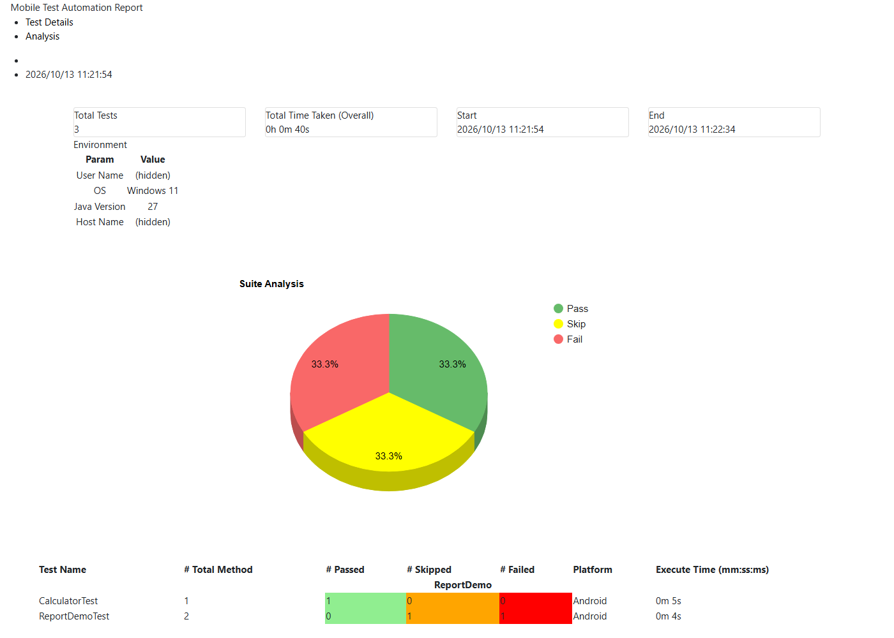
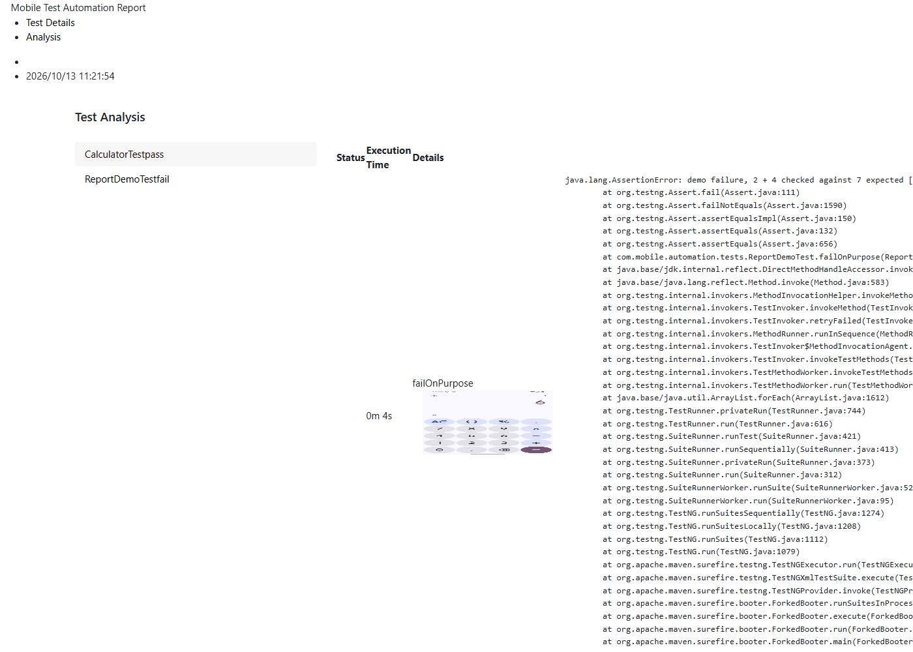
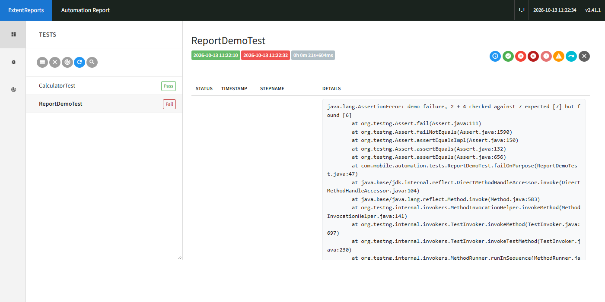
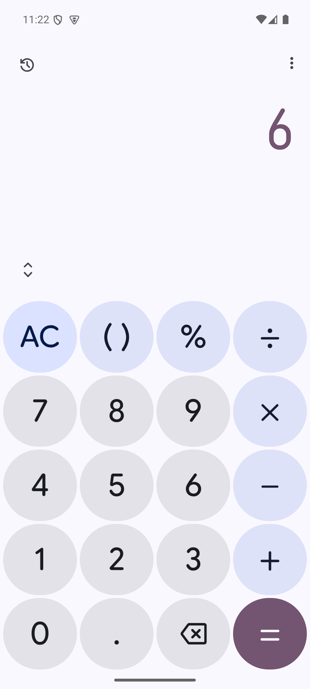

# Mobile Test Automation Framework

Appium + Java + TestNG framework for **Android and iOS** with one set of tests for both
platforms. First built in 2021 (Java 8, Appium 1), upgraded in 2026 to Java 17, Appium 3,
Appium Java client 11 and Selenium 4, without changing its design.

- Same test code on Android and iOS: a `platform` parameter in the suite file decides which
  session, locators and page objects are used.
- Device, app and server settings live in one properties file per platform, not in code.
- Page objects split into locators (element repository) and actions (page helper methods).
- Reports: a custom emailable HTML report with pie chart and failure screenshots, an Extent
  report, per-platform logs, and one automatic retry for failed tests.

Status: the Android suite runs green on an Android 15 emulator. The iOS side is complete in code
but has not been run yet (iOS automation needs a Mac); its locators are examples.

## Contents

- [Stack](#stack)
- [Project structure](#project-structure)
- [How a test run works](#how-a-test-run-works) (both platforms, step by step)
- [Capabilities: one file per platform](#capabilities-one-file-per-platform)
- [Setup and run on Android](#setup-and-run-on-android)
- [Setup and run on iOS](#setup-and-run-on-ios-mac-only)
- [Reports, screenshots and logs](#reports-screenshots-and-logs)
- [Report demo: a failure and a skip on purpose](#report-demo-a-failure-and-a-skip-on-purpose)
- [Adding a screen or a test](#adding-a-screen-or-a-test)
- [Known limitations](#known-limitations)

## Stack

| Part | Version |
|---|---|
| Java | 17 (builds and runs on newer JDKs, tested on 27) |
| Build | Maven, Surefire 3.x |
| Test runner | TestNG 7.12.0 |
| Appium Java client | 11.0.0 |
| Selenium support | 4.51.0 (waits, PageFactory support) |
| Appium server | 3.x with UiAutomator2 (Android) / XCUITest (iOS) |
| Reports | custom emailable HTML report, Extent Reports 2.41, log4j 2 |
| App under test | Google Calculator (Android) |

## Project structure

```
pom.xml
resources/
  config/
    android.properties        Android session: server URL + capabilities
    ios.properties            iOS session: server URL + capabilities (simulator / real device)
    log4j2.xml                logging: console, full log file, one log per platform
  suites/
    CalculatorTestSuite.xml        normal suite, platform = Android
    CalculatorTestSuite-iOS.xml    same tests, platform = iOS
    ReportDemoSuite.xml            pass + fail + skip, to show the reports
  template/
    report_template.html      HTML template of the custom emailable report
  apps/                       the app under test (not in git: calculator.apk, .app, .ipa)
src/main/java/com/mobile/automation/
  controller/
    Platform.java             what tests can ask for (getCalculatorPage)
    Android.java, IOS.java    one implementation per platform
    PlatformController.java   picks Android or IOS from the suite's platform parameter
  pagehelpermethods/
    Calculator.java           the calculator screen as tests see it (interface)
    android/CalculatorPage    Android actions  -> elementrepository/android/CalculatorPageFactory
    ios/CalculatorPage        iOS actions      -> elementrepository/ios/CalculatorPageFactory
  elementrepository/
    android/CalculatorPageFactory   @AndroidFindBy locators
    ios/CalculatorPageFactory       @iOSXCUITFindBy locators
  ui/selenium/
    BaseTestSuite.java        base class of all tests: session, platform, reports, logs
    DriverFactory.java        starts the Appium session from <platform>.properties
    BasePage.java             base of all page objects (+ test-data helpers)
    DriverActions.java        click, type, getText, waits ... used by every page
    TestListener.java         results, screenshots, retry hook, custom report
  core/RetryFailedTests.java  one retry per failed test
  util/Util.java              waits, random data, dates, files, CSV
src/test/java/com/mobile/automation/tests/
  CalculatorTest.java         2 + 4 = 6, runs on Android and iOS
  ReportDemoTest.java         fails and skips on purpose (report demo only)
docs/images/                  report screenshots used below
```

## How a test run works

The same test class runs on both platforms. Only one value in the suite file differs:

| | Android | iOS |
|---|---|---|
| Suite file | `CalculatorTestSuite.xml` | `CalculatorTestSuite-iOS.xml` |
| `platform` parameter | `Android` | `iOS` |
| Settings file | `config/android.properties` | `config/ios.properties` |
| Appium driver | UiAutomator2 (`AndroidDriver`) | XCUITest (`IOSDriver`) |
| `Platform` implementation | `controller/Android` | `controller/IOS` |
| Page object | `pagehelpermethods/android/CalculatorPage` | `pagehelpermethods/ios/CalculatorPage` |
| Locators | `@AndroidFindBy(id = "com.google.android.calculator:id/digit_2")` | `@iOSXCUITFindBy(accessibility = "2")` |
| Per-platform log | `target/android-default.log` | `target/ios-default.log` |

```
mvn test -Dsurefire.suiteXmlFiles=<suite file>
   |
   v
TestNG reads the suite  --->  TestListener is registered (results, screenshots, retry, report)
   |                          its static block points log4j to log4j2.xml and empties resources/screenshots
   v
BaseTestSuite  (every test class extends it)
   @BeforeSuite  open the Extent report
   @BeforeTest   put the platform into the log context (RoutingKey)
   @BeforeClass  setUp(platform):
                   Android -> DriverFactory.getAndroidInstance()   reads android.properties
                   iOS     -> DriverFactory.getIosInstance()       reads ios.properties
                   -> Appium installs/starts the app and returns the session
                 PlatformController.getPlatform(platform) -> app = new Android(driver) | new IOS(driver)
                 start one Extent entry for this test class
   |
   v
CalculatorTest.testCal()
   app.getCalculatorPage()  -> Android: android.CalculatorPage | iOS: ios.CalculatorPage  (both are a Calculator)
     .clickOnDigitTwo() / .clickOnAdd() / .clickOnDigitFour() / .clickOnEquals()
          -> DriverActions.clickElement(): wait until visible, click, log; one retry if the screen redrew
     .getResults()  -> DriverActions.getText()
   assertEquals(result, "6")
   |
   v
TestListener   onTestSuccess / onTestFailure (+ screenshot) / onTestSkipped -> log + Extent entry
               failure -> RetryFailedTests runs the test once more; the first attempt is reported as SKIP
   |
   v
BaseTestSuite  @AfterClass  close the Extent entry, quit the session (also after a failure)
               @AfterSuite  write test-output/extent-report.html
   |
   v
TestListener.generateReport() -> target/surefire-reports/custom-emailable-report.html
```

Step by step:

1. **Suite file.** It names the listener, the test classes and the `platform` parameter. Nothing
   else in the run depends on the operating system.
2. **Session (`DriverFactory`).** It loads `resources/config/<platform>.properties`. The server URL
   comes from `appium.server.url`, every `capability.<name>` line becomes one Appium capability.
   On Android Appium installs `resources/apps/calculator.apk` on the emulator; on iOS it installs
   the `.app` / `.ipa` and first builds WebDriverAgent onto the simulator or phone.
3. **Platform (`PlatformController`).** It returns `Android` or `IOS`; both implement `Platform`.
   `BaseTestSuite.app` holds it, and tests only ever use `app`.
4. **Page objects.** `app.getCalculatorPage()` returns a `Calculator`. On Android that is the page
   built on `@AndroidFindBy` locators, on iOS the one built on `@iOSXCUITFindBy` locators.
   Appium's PageFactory fills the fields with lazy proxies that find the element again on every use.
5. **Actions (`DriverActions`).** Every click, text entry and read waits for the element, logs the
   step and retries once if the screen redrew in between. Tests and pages never call the driver directly.
6. **Results (`TestListener`).** Each result is logged and written to the Extent report; a failure
   also saves the device screen to `resources/screenshots/<test>.png`. A failed test is retried once.
7. **Clean-up and reports.** The session ends after each class, even after a failure. At the end
   the Extent report and the custom emailable report are written.

## Capabilities: one file per platform

`resources/config/android.properties` (used as is on the Android 15 emulator):

```properties
appium.server.url=http://127.0.0.1:4723
capability.platformName=Android
capability.automationName=UiAutomator2
capability.platformVersion=15
capability.deviceName=emulator-5554
capability.app=resources/apps/calculator.apk
capability.newCommandTimeout=300
```

`resources/config/ios.properties` has the same format with `platformName=iOS`,
`automationName=XCUITest`, a simulator (`deviceName=iPhone 16`, `platformVersion=18.0`) and, as
comments, the settings for a real iPhone (`udid`, `xcodeOrgId`, `xcodeSigningId`) or an installed
app (`bundleId`).

How `DriverFactory` reads them:

- `platformName` is sent as is; every other name gets the W3C prefix (`automationName` becomes `appium:automationName`).
- `true` / `false` become booleans and whole numbers become numbers, except `platformVersion`, which Appium requires as text.
- `capability.app` is a path relative to the project folder; it is made absolute for the server.
- Any key can be overridden for one run with `-D<key>=<value>`:

```
mvn test -Dsurefire.suiteXmlFiles=resources/suites/CalculatorTestSuite.xml -Dcapability.deviceName=emulator-5556
```

## Setup and run on Android

Works on Windows, macOS and Linux.

1. **Java 17+ and Maven.**
2. **Android SDK** with platform-tools, the emulator and an Android 15 (API 35) system image;
   create an emulator (AVD). Android Studio is optional; the command-line tools are enough.
3. **Appium 3 and the Android driver:**
   ```
   npm install -g appium
   appium driver install uiautomator2
   ```
4. **App:** Google Calculator is not redistributed here. Download the APK (for example from
   APKMirror, which checks the developer signature) and save it as `resources/apps/calculator.apk`.
5. **Start the emulator and the server:**
   ```
   emulator -avd <your AVD name>
   appium
   ```
   If your emulator is not `emulator-5554` or not Android 15, change `android.properties` or pass `-D` overrides.
6. **Run:**
   ```
   mvn test -Dsurefire.suiteXmlFiles=resources/suites/CalculatorTestSuite.xml
   ```
   Expected: `Tests run: 1, Failures: 0, Errors: 0, Skipped: 0` (about 20 s after the app is installed).

## Setup and run on iOS (Mac only)

iOS automation needs Xcode, so it runs only on a Mac. The test code is the same as on Android.

1. **Xcode**: install it, open it once, accept the licence and install an iOS simulator runtime.
2. **Appium iOS driver:** `appium driver install xcuitest`
3. **App:** put the simulator build (`.app` folder) or the device build (`.ipa`) in `resources/apps`
   and set `capability.app` in `ios.properties`. Set `deviceName` and `platformVersion` to a simulator
   you have (`xcrun simctl list devices`). For a real iPhone use the commented device settings in the file.
4. **Locators:** start a session in Appium Inspector with the capabilities from `ios.properties`,
   tap each key and copy its accessibility id into `elementrepository/ios/CalculatorPageFactory`.
   The ids in the repository (`"2"`, `"4"`, `"+"`, `"="`, `"result"`) are examples.
5. **Start the server and run:**
   ```
   appium
   mvn test -Dsurefire.suiteXmlFiles=resources/suites/CalculatorTestSuite-iOS.xml
   ```
   The first run takes a few minutes because Appium builds WebDriverAgent onto the simulator.

## Reports, screenshots and logs

| Output | What it shows |
|---|---|
| `target/surefire-reports/custom-emailable-report.html` | dashboard (times, environment, totals, pie chart), one row per test class with its platform, and per method the status, time, screenshot and stack trace |
| `test-output/extent-report.html` | Extent report: one entry per test class with PASS / FAIL / SKIP and the exception |
| `resources/screenshots/<test method>.png` | the device screen at the moment a test failed |
| `target/taf-default.log` | full log of the run |
| `target/android-default.log`, `target/ios-default.log` | the framework's own log lines, per platform |
| `target/surefire-reports/` | TestNG's own reports (`index.html`, `testng-results.xml`) |

A failed test is retried once (`RetryFailedTests`). Its first attempt is reported as SKIP; if the
retry passes, that SKIP entry is removed, so only the final result counts.

The screenshots below come from the report demo run (one pass, one fail, one skip) on the Android 15
emulator. User and host name in the environment tables are hidden.

**Custom emailable report: dashboard.** Totals, run time, environment, pie chart, and one row per test
class with passed / skipped / failed and the platform:



**Custom emailable report: analysis view.** Per test method: status, time, a thumbnail of the failure
screenshot (click to enlarge) and the stack trace:



**Extent report.** One entry per test class; the failed class shows the assertion message and stack trace:



**Failure screenshot** saved by the listener (`failOnPurpose.png`): the calculator shows 6, the test expected 7.



## Report demo: a failure and a skip on purpose

`ReportDemoTest` has one test that fails on purpose (2 + 4 checked against 7) and one that is skipped on
purpose (`SkipException` with a reason). They run only in their own suite, so the normal suite stays green:

```
mvn test -Dsurefire.suiteXmlFiles=resources/suites/ReportDemoSuite.xml
```

Expected Maven summary: `Tests run: 3, Failures: 1, Errors: 0, Skipped: 1` and BUILD FAILURE (on purpose).
The line marked "in TestSuite" shows 4 runs and 2 skips, because it also counts the first attempt of the
retried test. The reports then look like the screenshots above.

## Adding a screen or a test

1. **Locators:** a `...PageFactory` class per platform in `elementrepository/android` and
   `elementrepository/ios`, with `@AndroidFindBy` / `@iOSXCUITFindBy` fields.
2. **Actions:** an interface in `pagehelpermethods` (like `Calculator`) and one page class per platform
   that extends its PageFactory class and implements the interface. Use the `DriverActions` methods
   (`clickElement`, `sendKeys`, `getText`, waits) instead of calling the driver.
3. **Platform:** add a getter to `Platform` and implement it in `Android` and `IOS`.
4. **Test:** a class in `src/test/java/.../tests` that extends `BaseTestSuite` and uses `app.getXxxPage()`;
   add it to the suite files.

## Known limitations

- **iOS has not been run yet** (it needs a Mac). Session settings, page objects and suite are in place;
  the iOS locators are examples to check with Appium Inspector.
- **One session at a time:** the driver and `app` are static in `BaseTestSuite`, so classes cannot run in
  parallel yet.
- **Web-only helpers:** some `DriverActions` methods (JavaScript, windows, frames, page title/URL, HTML
  selects) come from the web framework this one started from. They are marked "Web/hybrid context only"
  and work only inside a web view.
- **Report styling** loads Bootstrap, w3.css and Google Charts from CDNs, so the custom report needs
  internet access to look right.
